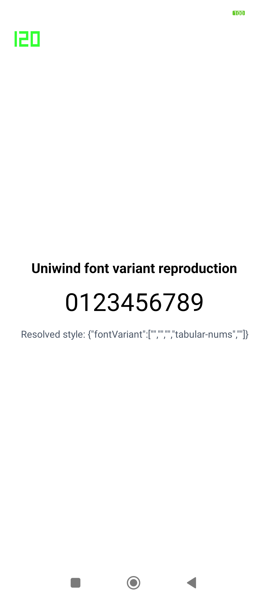

# Uniwind empty font variant reproduction

This Expo app reproduces empty `fontVariant` values from Uniwind 1.12.2 with React Native 0.88.0-rc.3.

## Run it

1. Install dependencies with `bun install`.
2. Start Metro with `bun start`.
3. Open the app in an Android development build.

The screen and JavaScript console show:

```text
{"fontVariant":["","","","tabular-nums",""]}
```

The same empty items caused repeated `E ReactNativeJNI: Unsupported FontVariant value:` lines in the T3 Code Android production app. The text still renders because React Native skips the empty values. Uniwind should pass only `tabular-nums` to React Native.


